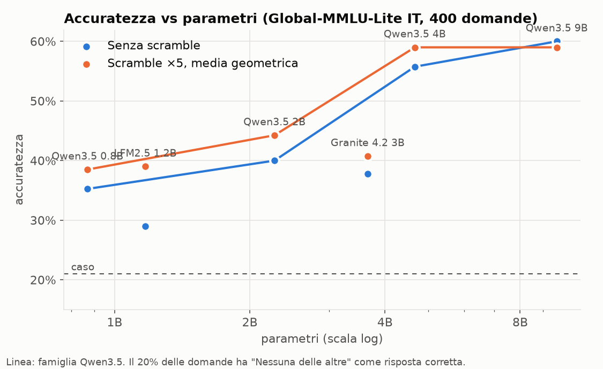
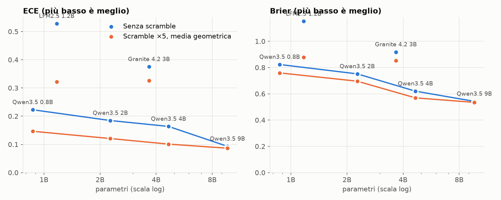
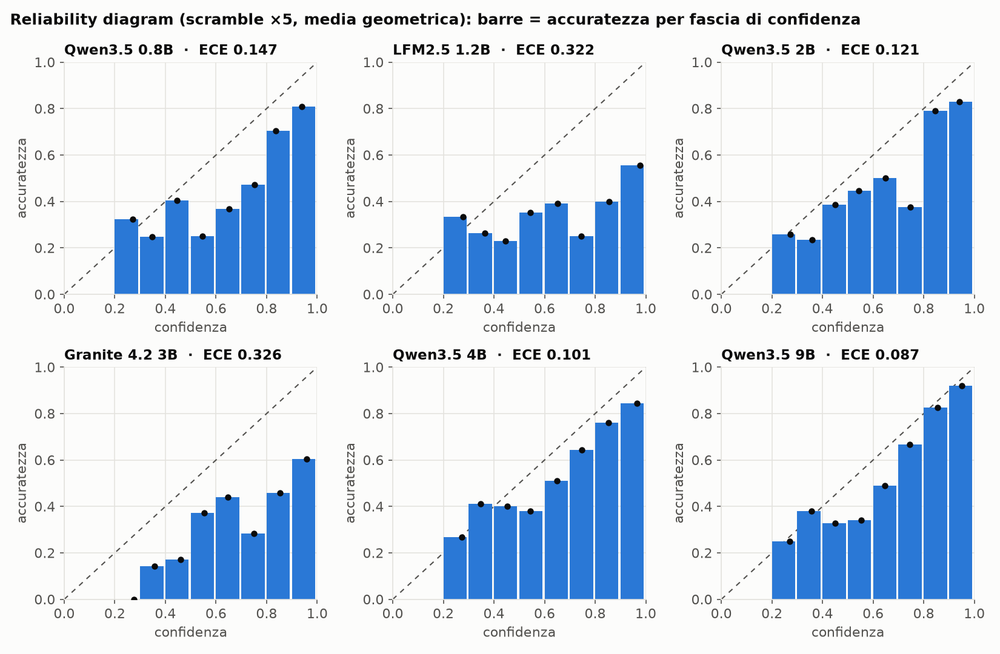
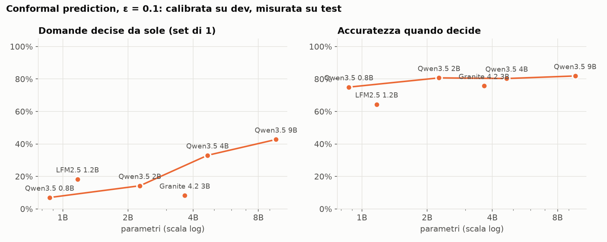
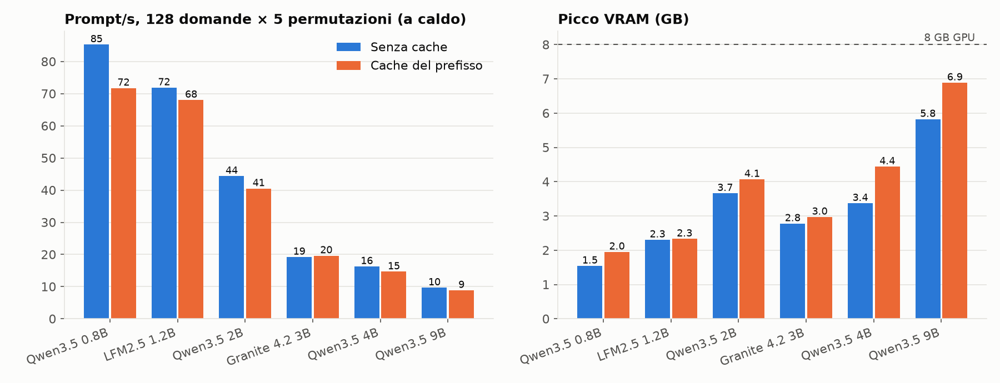
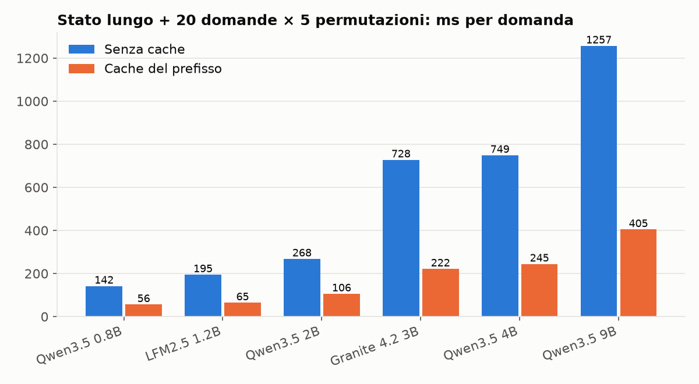

# Risultati del benchmark

Dataset: Global-MMLU-Lite, split italiano. 215 domande dev (calibrazione), 400 test (valutazione).
Al 20% delle domande è stata tolta l'opzione corretta, quindi la risposta giusta è "Nessuna delle altre".
Accuratezza del caso: 21.0%. Prompt: `it-strict`. GPU: 8 GB.

Rigenerare con `uv run python bench/run_bench.py eval && uv run python bench/run_bench.py stress && uv run python bench/report.py`.

## Accuratezza

| Modello | Parametri | Senza scramble | Scramble geomean | mean | weighted | vote | Su domande "nessuna" (geomean) |
|---|---|---|---|---|---|---|---|
| Qwen3.5 0.8B | 0.87B | 35.2% | 38.5% | 38.0% | 38.0% | 38.0% | 27.6% |
| LFM2.5 1.2B | 1.17B | 29.0% | 39.0% | 37.5% | 37.5% | 37.5% | 14.9% |
| Qwen3.5 2B | 2.27B | 40.0% | 44.2% | 43.5% | 43.5% | 42.0% | 36.8% |
| Granite 4.2 3B | 3.66B | 37.8% | 40.8% | 41.0% | 41.0% | 42.5% | 52.9% |
| Qwen3.5 4B | 4.66B | 55.8% | 59.0% | 58.8% | 58.8% | 58.2% | 27.6% |
| Qwen3.5 9B | 9.65B | 60.0% | 59.0% | 59.0% | 59.2% | 58.8% | 27.6% |

## Calibrazione

| Modello | ECE senza scramble | ECE scramble | Brier senza scramble | Brier scramble | Massa sulle lettere |
|---|---|---|---|---|---|
| Qwen3.5 0.8B | 0.223 | 0.147 | 0.823 | 0.759 | 99.1% |
| LFM2.5 1.2B | 0.528 | 0.322 | 1.152 | 0.879 | 100.0% |
| Qwen3.5 2B | 0.185 | 0.121 | 0.752 | 0.696 | 99.5% |
| Granite 4.2 3B | 0.375 | 0.326 | 0.919 | 0.854 | 99.7% |
| Qwen3.5 4B | 0.164 | 0.101 | 0.620 | 0.569 | 98.1% |
| Qwen3.5 9B | 0.093 | 0.087 | 0.543 | 0.535 | 94.7% |

## Conformal prediction (ε = 0.1)

| Modello | Copertura | Decise da sole | Accuratezza quando decide | Set medio |
|---|---|---|---|---|
| Qwen3.5 0.8B | 89.0% | 7.0% | 75.0% | 3.67 |
| LFM2.5 1.2B | 84.5% | 18.2% | 64.4% | 3.37 |
| Qwen3.5 2B | 86.2% | 14.2% | 80.7% | 3.09 |
| Granite 4.2 3B | 91.5% | 8.2% | 75.8% | 3.62 |
| Qwen3.5 4B | 84.8% | 33.0% | 80.3% | 2.43 |
| Qwen3.5 9B | 82.2% | 42.8% | 81.9% | 1.99 |

## Set-based attention (Granite)

Le opzioni condividono le stesse posizioni e non si vedono tra loro: il risultato non dipende dal loro ordine. Le lettere restano legate alle opzioni, quindi il bias sulle etichette resta.

| Modello | Config | Accuratezza | ECE | Bias posizionale A-E |
|---|---|---|---|---|
| Granite 4.2 3B | normale | 37.8% | 0.375 | 16 17 16 19 40 |
| Granite 4.2 3B | set attention | 18.2% | 0.273 | 28 16 34 14 10 |
| Granite 4.2 3B | scramble | 40.8% | 0.326 | 16 25 28 17 18 |
| Granite 4.2 3B | set attention + scramble | 30.5% | 0.075 | 29 15 34 14 10 |

## Velocità e memoria (a caldo)

128 domande di test × 5 permutazioni = 640 prompt. Ogni configurazione è eseguita due volte e si misura la seconda (i kernel Triton vengono compilati alla prima).

| Modello | Config | Forward (s) | Prompt/s | Token/s | Picco VRAM | Righe max | Padding |
|---|---|---|---|---|---|---|---|
| Qwen3.5 0.8B | budget 2048 token | 7.5 | 85 | 7521 | 1.54 GB | 21 | 10% |
| Qwen3.5 0.8B | budget 4096 token | 8.2 | 78 | 6870 | 1.69 GB | 42 | 11% |
| Qwen3.5 0.8B | budget 8192 token | 8.8 | 72 | 6379 | 1.97 GB | 85 | 10% |
| Qwen3.5 0.8B | budget 2048 + cache prefisso | 8.9 | 72 | 5400 | 1.95 GB | 20 | 27% |
| LFM2.5 1.2B | budget 2048 token | 8.9 | 72 | 6396 | 2.31 GB | 21 | 10% |
| LFM2.5 1.2B | budget 4096 token | 9.2 | 70 | 6220 | 2.43 GB | 42 | 10% |
| LFM2.5 1.2B | budget 8192 token | 11.1 | 57 | 5111 | 2.68 GB | 85 | 10% |
| LFM2.5 1.2B | budget 2048 + cache prefisso | 9.4 | 68 | 5119 | 2.33 GB | 20 | 27% |
| Qwen3.5 2B | budget 2048 token | 14.4 | 44 | 3914 | 3.66 GB | 21 | 10% |
| Qwen3.5 2B | budget 4096 token | 15.2 | 42 | 3723 | 3.82 GB | 42 | 11% |
| Qwen3.5 2B | budget 8192 token | 17.8 | 36 | 3174 | 4.14 GB | 85 | 10% |
| Qwen3.5 2B | budget 2048 + cache prefisso | 15.8 | 41 | 3049 | 4.07 GB | 20 | 27% |
| Granite 4.2 3B | budget 2048 token | 33.3 | 19 | 1875 | 2.78 GB | 21 | 11% |
| Granite 4.2 3B | budget 4096 token | 34.3 | 19 | 1819 | 2.88 GB | 42 | 12% |
| Granite 4.2 3B | budget 8192 token | 38.9 | 16 | 1604 | 3.14 GB | 85 | 12% |
| Granite 4.2 3B | budget 2048 + cache prefisso | 32.6 | 20 | 1561 | 2.97 GB | 20 | 22% |
| Granite 4.2 3B | budget 2048 + set attention | 33.0 | 19 | 1873 | 2.78 GB | 21 | 10% |
| Qwen3.5 4B | budget 2048 token | 39.3 | 16 | 1436 | 3.37 GB | 21 | 10% |
| Qwen3.5 4B | budget 4096 token | 40.1 | 16 | 1407 | 3.65 GB | 42 | 11% |
| Qwen3.5 4B | budget 8192 token | 44.7 | 14 | 1263 | 4.21 GB | 85 | 10% |
| Qwen3.5 4B | budget 2048 + cache prefisso | 43.7 | 15 | 1102 | 4.44 GB | 20 | 27% |
| Qwen3.5 9B | budget 1024 token | 72.6 | 9 | 777 | 5.73 GB | 10 | 10% |
| Qwen3.5 9B | budget 2048 token | 66.2 | 10 | 853 | 5.82 GB | 21 | 10% |
| Qwen3.5 9B | budget 4096 token | 78.2 | 8 | 722 | 6.12 GB | 42 | 11% |
| Qwen3.5 9B | budget 2048 + cache prefisso | 72.3 | 9 | 666 | 6.89 GB | 20 | 27% |

Le domande di test sono brevi e il testo in comune tra le permutazioni è circa il 15% dei token: qui la copia della cache costa più del prefill risparmiato. Per questo il motore attiva la cache solo quando risparmia almeno il 25% dei token, come con uno stato condiviso.

### Stato lungo condiviso

Uno stato di circa 250 parole e 20 domande (scelta, punteggio, sì/no) × 5 permutazioni.

| Modello | Senza cache (ms/domanda) | Con cache (ms/domanda) | Speedup | Token risparmiati |
|---|---|---|---|---|
| Qwen3.5 0.8B | 142 | 56 | 2.5× | 16920 |
| LFM2.5 1.2B | 195 | 65 | 3.0× | 20880 |
| Qwen3.5 2B | 268 | 106 | 2.5× | 16920 |
| Granite 4.2 3B | 728 | 222 | 3.3× | 22608 |
| Qwen3.5 4B | 749 | 245 | 3.1× | 16920 |
| Qwen3.5 9B | 1257 | 405 | 3.1× | 16920 |

## Note

- In bf16 il risultato di un prompt può variare leggermente con la composizione del batch (forme diverse, kernel diversi): sulle domande incerte circa l'1-2% degli argmax cambia. In fp32 il padding non altera i risultati (verificato).
- La GPU di test è una RTX PRO 1000 Laptop (8 GB) limitata in potenza: sotto carico lavora a circa 1 GHz su 3.09.
