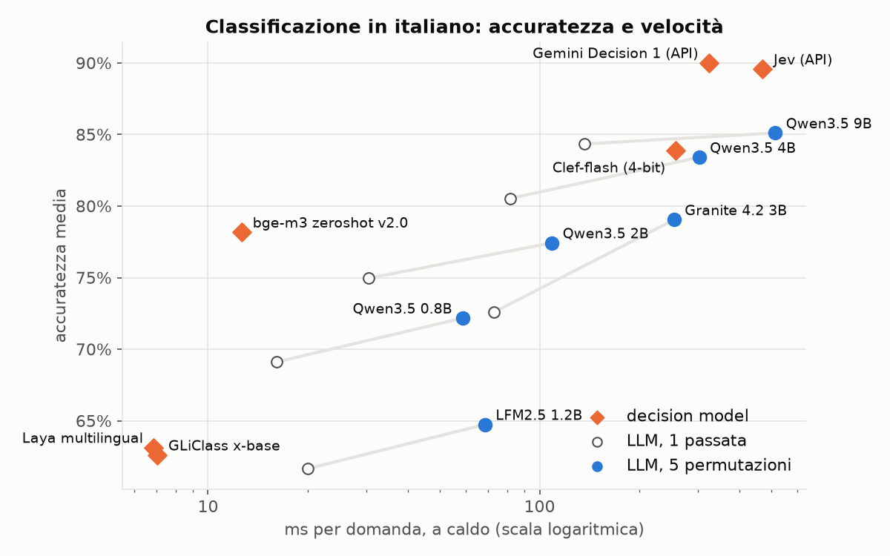

# Risultati del benchmark

Dataset: Global-MMLU-Lite, split italiano. 215 domande dev (calibrazione), 400 test (valutazione).
Al 20% delle domande è stata tolta l'opzione corretta, quindi la risposta giusta è "Nessuna delle altre".
Accuratezza del caso: 21.0%. Prompt: `it-strict`. GPU: 8 GB.

Rigenerare con `uv run python bench/run_bench.py eval && uv run python bench/run_bench.py stress && uv run python bench/report.py`.

## Accuratezza

| Modello | Parametri | Senza scramble | Scramble geomean | mean | weighted | vote | Su domande "nessuna" (geomean) |
|---|---|---|---|---|---|---|---|
| Qwen3.5 0.8B | 0.87B | 35.2% | 38.5% | 38.0% | 38.0% | 38.0% | 27.6% |
| LFM2.5 1.2B | 1.17B | 29.0% | 39.0% | 37.5% | 37.5% | 37.5% | 14.9% |
| Qwen3.5 2B | 2.27B | 40.0% | 44.2% | 43.5% | 43.5% | 42.0% | 36.8% |
| Granite 4.2 3B | 3.66B | 37.8% | 40.8% | 41.0% | 41.0% | 42.5% | 52.9% |
| Qwen3.5 4B | 4.66B | 55.8% | 59.0% | 58.8% | 58.8% | 58.2% | 27.6% |
| Qwen3.5 9B | 9.65B | 60.0% | 59.0% | 59.0% | 59.2% | 58.8% | 27.6% |

## Calibrazione

| Modello | ECE senza scramble | ECE scramble | Brier senza scramble | Brier scramble | Massa sulle lettere |
|---|---|---|---|---|---|
| Qwen3.5 0.8B | 0.223 | 0.147 | 0.823 | 0.759 | 99.1% |
| LFM2.5 1.2B | 0.528 | 0.322 | 1.152 | 0.879 | 100.0% |
| Qwen3.5 2B | 0.185 | 0.121 | 0.752 | 0.696 | 99.5% |
| Granite 4.2 3B | 0.375 | 0.326 | 0.919 | 0.854 | 99.7% |
| Qwen3.5 4B | 0.164 | 0.101 | 0.620 | 0.569 | 98.1% |
| Qwen3.5 9B | 0.093 | 0.087 | 0.543 | 0.535 | 94.7% |

## Conformal prediction (ε = 0.1)

| Modello | Copertura | Decise da sole | Accuratezza quando decide | Set medio |
|---|---|---|---|---|
| Qwen3.5 0.8B | 89.0% | 7.0% | 75.0% | 3.67 |
| LFM2.5 1.2B | 84.5% | 18.2% | 64.4% | 3.37 |
| Qwen3.5 2B | 86.2% | 14.2% | 80.7% | 3.09 |
| Granite 4.2 3B | 91.5% | 8.2% | 75.8% | 3.62 |
| Qwen3.5 4B | 84.8% | 33.0% | 80.3% | 2.43 |
| Qwen3.5 9B | 82.2% | 42.8% | 81.9% | 1.99 |

## Set-based attention (Granite)

Le opzioni condividono le stesse posizioni e non si vedono tra loro: il risultato non dipende dal loro ordine. Le lettere restano legate alle opzioni, quindi il bias sulle etichette resta.

| Modello | Config | Accuratezza | ECE | Bias posizionale A-E |
|---|---|---|---|---|
| Granite 4.2 3B | normale | 37.8% | 0.375 | 16 17 16 19 40 |
| Granite 4.2 3B | set attention | 18.2% | 0.273 | 28 16 34 14 10 |
| Granite 4.2 3B | scramble | 40.8% | 0.326 | 16 25 28 17 18 |
| Granite 4.2 3B | set attention + scramble | 30.5% | 0.075 | 29 15 34 14 10 |

## Velocità e memoria (a caldo)

128 domande di test × 5 permutazioni = 640 prompt. Ogni configurazione è eseguita due volte e si misura la seconda (i kernel Triton vengono compilati alla prima).

| Modello | Config | Forward (s) | Prompt/s | Token/s | Picco VRAM | Righe max | Padding |
|---|---|---|---|---|---|---|---|
| Qwen3.5 0.8B | budget 2048 token | 7.5 | 85 | 7521 | 1.54 GB | 21 | 10% |
| Qwen3.5 0.8B | budget 4096 token | 8.2 | 78 | 6870 | 1.69 GB | 42 | 11% |
| Qwen3.5 0.8B | budget 8192 token | 8.8 | 72 | 6379 | 1.97 GB | 85 | 10% |
| Qwen3.5 0.8B | budget 2048 + cache prefisso | 8.9 | 72 | 5400 | 1.95 GB | 20 | 27% |
| LFM2.5 1.2B | budget 2048 token | 8.9 | 72 | 6396 | 2.31 GB | 21 | 10% |
| LFM2.5 1.2B | budget 4096 token | 9.2 | 70 | 6220 | 2.43 GB | 42 | 10% |
| LFM2.5 1.2B | budget 8192 token | 11.1 | 57 | 5111 | 2.68 GB | 85 | 10% |
| LFM2.5 1.2B | budget 2048 + cache prefisso | 9.4 | 68 | 5119 | 2.33 GB | 20 | 27% |
| Qwen3.5 2B | budget 2048 token | 14.4 | 44 | 3914 | 3.66 GB | 21 | 10% |
| Qwen3.5 2B | budget 4096 token | 15.2 | 42 | 3723 | 3.82 GB | 42 | 11% |
| Qwen3.5 2B | budget 8192 token | 17.8 | 36 | 3174 | 4.14 GB | 85 | 10% |
| Qwen3.5 2B | budget 2048 + cache prefisso | 15.8 | 41 | 3049 | 4.07 GB | 20 | 27% |
| Granite 4.2 3B | budget 2048 token | 33.3 | 19 | 1875 | 2.78 GB | 21 | 11% |
| Granite 4.2 3B | budget 4096 token | 34.3 | 19 | 1819 | 2.88 GB | 42 | 12% |
| Granite 4.2 3B | budget 8192 token | 38.9 | 16 | 1604 | 3.14 GB | 85 | 12% |
| Granite 4.2 3B | budget 2048 + cache prefisso | 32.6 | 20 | 1561 | 2.97 GB | 20 | 22% |
| Granite 4.2 3B | budget 2048 + set attention | 33.0 | 19 | 1873 | 2.78 GB | 21 | 10% |
| Qwen3.5 4B | budget 2048 token | 39.3 | 16 | 1436 | 3.37 GB | 21 | 10% |
| Qwen3.5 4B | budget 4096 token | 40.1 | 16 | 1407 | 3.65 GB | 42 | 11% |
| Qwen3.5 4B | budget 8192 token | 44.7 | 14 | 1263 | 4.21 GB | 85 | 10% |
| Qwen3.5 4B | budget 2048 + cache prefisso | 43.7 | 15 | 1102 | 4.44 GB | 20 | 27% |
| Qwen3.5 9B | budget 1024 token | 72.6 | 9 | 777 | 5.73 GB | 10 | 10% |
| Qwen3.5 9B | budget 2048 token | 66.2 | 10 | 853 | 5.82 GB | 21 | 10% |
| Qwen3.5 9B | budget 4096 token | 78.2 | 8 | 722 | 6.12 GB | 42 | 11% |
| Qwen3.5 9B | budget 2048 + cache prefisso | 72.3 | 9 | 666 | 6.89 GB | 20 | 27% |

Le domande di test sono brevi e il testo in comune tra le permutazioni è circa il 15% dei token: qui la copia della cache costa più del prefill risparmiato. Per questo il motore attiva la cache solo quando risparmia almeno il 25% dei token, come con uno stato condiviso.

### Stato lungo condiviso

Uno stato di circa 250 parole e 20 domande (scelta, punteggio, sì/no) × 5 permutazioni.

| Modello | Senza cache (ms/domanda) | Con cache (ms/domanda) | Speedup | Token risparmiati |
|---|---|---|---|---|
| Qwen3.5 0.8B | 142 | 56 | 2.5× | 16920 |
| LFM2.5 1.2B | 195 | 65 | 3.0× | 20880 |
| Qwen3.5 2B | 268 | 106 | 2.5× | 16920 |
| Granite 4.2 3B | 728 | 222 | 3.3× | 22608 |
| Qwen3.5 4B | 749 | 245 | 3.1× | 16920 |
| Qwen3.5 9B | 1257 | 405 | 3.1× | 16920 |

## Confronto con i decision model

Gli stessi dataset per tutti i sistemi, con i modelli locali sulla stessa GPU. Decision model: Laya multilingual (Convai, mmBERT 322M, stato e domande tipizzate), Clef-flash (Cloudflare, Qwen3.5 9B con una testa sulle opzioni, in 4 bit), bge-m3 zeroshot v2.0 (MoritzLaurer, cross-encoder NLI, una passata per opzione), GLiClass x-base (Knowledgator, mDeBERTa, tutte le opzioni in una passata), Jev di TypeSafe via l'API di classifier.dev e Gemini Decision 1 via la Gemini Decisions API (i tempi dei due servizi API includono la rete). Ogni sistema restituisce una distribuzione sulle opzioni della domanda. Sul dev si fittano una temperatura (ECE con T) e la soglia della conformal prediction (ε 10%).

Rigenerare con `uv sync --group baselines && uv run python bench/compare.py baselines && uv run python bench/compare.py llm`.

| Dataset | Test | Dev | Tipo |
|---|---|---|---|
| MASSIVE intent (5 opzioni) | 500 | 200 | scelta tra 5 intent, fino a 2 dello stesso dominio |
| SIB-200 argomento (7 opzioni) | 204 | 99 | scelta tra 7 argomenti |
| SIB-200 sì / no | 204 | 99 | "Il testo parla di X?", metà vere |
| Sentiment tweet (punteggio 3 livelli) | 500 | 300 | punteggio su 3 livelli |
| 256 domande locali | 256 | – | scelta tra 4 opzioni più "Nessuna delle altre" |
| Global-MMLU-Lite | 400 | 215 | come sopra, 20% con risposta "Nessuna delle altre" |

### Accuratezza per dataset

| Sistema | Modalità | Parametri | MASSIVE intent (5 opzioni) | SIB-200 argomento (7 opzioni) | SIB-200 sì / no | Sentiment tweet (punteggio 3 livelli) | 256 domande locali | Global-MMLU-Lite | Media classificazione |
|---|---|---|---|---|---|---|---|---|---|
| Laya multilingual | 1 passata | 0.32B | 63.2% | 68.1% | 69.6% | 51.6% | 25.0% | 23.2% | **63.1%** |
| bge-m3 zeroshot v2.0 | 1 passata | 0.57B | 80.8% | 83.8% | 86.3% | 61.8% | 34.8% | 29.0% | **78.2%** |
| GLiClass x-base | 1 passata | 0.3B | 75.6% | 73.5% | 50.5% | 50.8% | 50.4% | 26.0% | **62.6%** |
| Jev (API) | API | – | 93.4% | 90.7% | 94.6% | 79.6% | 97.3% | 78.5% | **89.6%** |
| Clef-flash (4-bit) | 1 passata | 9.65B | 95.4% | 88.2% | 93.6% | 58.2% | 93.4% | 74.8% | **83.9%** |
| Gemini Decision 1 (API) | API | – | 93.8% | 91.7% | 94.6% | 80.0% | 100.0% | 81.5% | **90.0%** |
| Qwen3.5 0.8B | 1 passata | 0.87B | 67.0% | 76.5% | 86.8% | 46.2% | 61.3% | 35.2% | **69.1%** |
| Qwen3.5 0.8B | 5 permutazioni | 0.87B | 75.0% | 83.3% | 77.0% | 53.4% | 62.5% | 38.0% | **72.2%** |
| LFM2.5 1.2B | 1 passata | 1.17B | 69.2% | 80.4% | 50.0% | 47.0% | 55.5% | 29.2% | **61.6%** |
| LFM2.5 1.2B | 5 permutazioni | 1.17B | 76.2% | 82.4% | 50.0% | 50.4% | 64.1% | 38.5% | **64.7%** |
| Qwen3.5 2B | 1 passata | 2.27B | 75.0% | 82.8% | 85.8% | 56.2% | 70.7% | 39.5% | **75.0%** |
| Qwen3.5 2B | 5 permutazioni | 2.27B | 78.8% | 85.3% | 89.2% | 56.4% | 74.2% | 44.2% | **77.4%** |
| Granite 4.2 3B | 1 passata | 3.66B | 76.8% | 83.8% | 77.0% | 52.8% | 70.3% | 37.5% | **72.6%** |
| Granite 4.2 3B | 5 permutazioni | 3.66B | 81.4% | 88.2% | 88.7% | 57.8% | 74.2% | 40.8% | **79.0%** |
| Qwen3.5 4B | 1 passata | 4.66B | 84.6% | 87.7% | 90.2% | 59.6% | 79.7% | 55.8% | **80.5%** |
| Qwen3.5 4B | 5 permutazioni | 4.66B | 88.4% | 92.2% | 91.7% | 61.4% | 80.9% | 59.2% | **83.4%** |
| Qwen3.5 9B | 1 passata | 9.65B | 86.0% | 90.7% | 91.7% | 69.0% | 85.5% | 59.8% | **84.3%** |
| Qwen3.5 9B | 5 permutazioni | 9.65B | 89.2% | 91.7% | 92.2% | 67.4% | 91.0% | 58.5% | **85.1%** |

### Calibrazione, conformal e velocità (media dei 4 dataset di classificazione)

| Sistema | Modalità | ECE | ECE con T | Brier | Decide da solo | Acc. quando decide | ms / domanda | Picco VRAM |
|---|---|---|---|---|---|---|---|---|
| Laya multilingual | 1 passata | 0.113 | 0.049 | 0.506 | 33.1% | 80.7% | 6.9 | 1.54 GB |
| bge-m3 zeroshot v2.0 | 1 passata | 0.119 | 0.056 | 0.313 | 65.2% | 91.2% | 12.7 | 1.06 GB |
| GLiClass x-base | 1 passata | 0.211 | 0.101 | 0.564 | 45.9% | 80.0% | 7.0 | 1.32 GB |
| Jev (API) | API | 0.051 | 0.086 | 0.169 | 88.8% | 92.5% | 471.2 | API |
| Clef-flash (4-bit) | 1 passata | 0.067 | 0.032 | 0.230 | 77.3% | 89.3% | 257.9 | 4.45 GB |
| Gemini Decision 1 (API) | API | 0.046 | 0.036 | 0.146 | 90.4% | 93.1% | 324.1 | API |
| Qwen3.5 0.8B | 1 passata | 0.148 | 0.068 | 0.459 | 43.5% | 89.5% | 16.1 | 1.54 GB |
| Qwen3.5 0.8B | 5 permutazioni | 0.098 | 0.058 | 0.385 | 49.4% | 88.8% | 58.7 | 1.88 GB |
| LFM2.5 1.2B | 1 passata | 0.340 | 0.096 | 0.713 | 51.4% | 79.0% | 19.9 | 2.30 GB |
| LFM2.5 1.2B | 5 permutazioni | 0.312 | 0.072 | 0.651 | 58.1% | 81.7% | 68.4 | 2.32 GB |
| Qwen3.5 2B | 1 passata | 0.121 | 0.067 | 0.373 | 44.7% | 93.1% | 30.5 | 3.66 GB |
| Qwen3.5 2B | 5 permutazioni | 0.141 | 0.074 | 0.349 | 61.2% | 89.2% | 108.9 | 4.00 GB |
| Granite 4.2 3B | 1 passata | 0.129 | 0.075 | 0.399 | 55.0% | 83.8% | 73.0 | 2.78 GB |
| Granite 4.2 3B | 5 permutazioni | 0.126 | 0.036 | 0.327 | 75.3% | 86.9% | 254.2 | 2.97 GB |
| Qwen3.5 4B | 1 passata | 0.091 | 0.055 | 0.276 | 80.1% | 88.4% | 81.7 | 3.37 GB |
| Qwen3.5 4B | 5 permutazioni | 0.084 | 0.056 | 0.250 | 84.4% | 88.6% | 302.8 | 4.25 GB |
| Qwen3.5 9B | 1 passata | 0.085 | 0.042 | 0.240 | 80.4% | 91.4% | 136.7 | 5.82 GB |
| Qwen3.5 9B | 5 permutazioni | 0.083 | 0.038 | 0.219 | 83.4% | 90.8% | 513.6 | 6.41 GB |

Note sul metodo:

- Laya valuta in un'unica passata più stati con la stessa domanda (`predict_batch`). Su MASSIVE, domande locali e MMLU le opzioni cambiano da domanda a domanda, quindi Laya fa una chiamata per domanda.
- Il cross-encoder NLI riceve un'ipotesi per opzione ("Questo testo parla di {}.", "L'utente vuole: {}."...) e la probabilità di implicazione normalizzata sulle opzioni. Per il sì / no usa la probabilità di implicazione dell'ipotesi.
- GLiClass dà un sigmoid per opzione: sulle domande a scelta i logit vengono normalizzati con una softmax, sul sì / no il sigmoid dell'argomento chiesto è P(sì). Con una sola etichetta il sigmoid resta quasi sempre sotto 0.5, quindi la risposta è quasi sempre "No" e l'accuratezza è vicina al caso. La temperatura cambia la scala ma non la soglia.
- Jev è chiamato via API (classifier.dev, `/v1/systemone`), una richiesta per domanda: i tempi includono la rete. L'API arrotonda le probabilità a due decimali, quindi alcune opzioni valgono 0: la temperatura fittata sul NLL tende a valori alti e l'ECE grezza è la misura più fedele.
- Clef-flash usa il codice e la testa del rilascio (`joint_schema_model.py`). Il backbone è caricato come il nostro Qwen3.5 9B (layer in NF4 sulla GPU, embedding e `lm_head` sulla CPU), perché il rilascio in bf16 richiede circa 19 GB: i risultati possono scostarsi da quelli in bf16. Sul sentiment (domanda a punteggio) Clef tende al livello centrale: sui primi 200 tweet del test risponde "Neutro" al 79% dei negativi e al 57% dei positivi.
- Gemini Decision 1 è chiamato via Gemini Decisions API (`/v1beta/decisions`, `gemini-decision-1`), una richiesta per domanda con le stesse domande tipizzate di Jev: i tempi includono la rete. Un tweet del sentiment viene rifiutato dai filtri di sicurezza (HTTP 400) e conta come probabilità uniformi.
- LFM2.5 1.2B risponde "Sì" a ogni domanda sì / no di SIB-200 con probabilità vicina a 1, in entrambi gli ordini delle opzioni: segue la parola, non la lettera. Accuratezza 50% con e senza permutazioni.
- I nostri LLM con una passata leggono le opzioni nell'ordine originale; con 5 permutazioni le opzioni ruotano e le probabilità sono aggregate con la media geometrica. La temperatura e la soglia conforme sono fittate separatamente per ogni modalità.

## Note

- In bf16 il risultato di un prompt può variare leggermente con la composizione del batch (forme diverse, kernel diversi): sulle domande incerte circa l'1-2% degli argmax cambia. In fp32 il padding non altera i risultati (verificato).
- La GPU di test è una RTX PRO 1000 Laptop (8 GB) limitata in potenza: sotto carico lavora a circa 1 GHz su 3.09.
